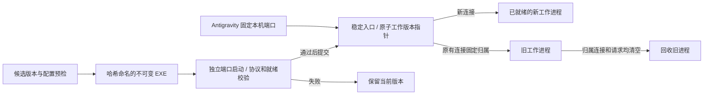

# 架构与升级流程

## v5.27：应用更新兼容性

启动器在安装互斥锁内等待配置程序恢复，最长约 10 秒。仅在原路径不存在时查询 HKCU/HKLM 两种位数的卸载登记，支持带版本号的 DisplayName、InstallLocation 与带图标索引的 DisplayIcon；不执行注册表中的命令。候选必须是本地绝对路径 Antigravity.exe、x86/x64 PE，并在同目录 resources/app.asar 中包含匹配的 package.json 标识；ASAR 头与元数据读取有长度及偏移边界。唯一候选连续可用至少 500 ms 后原子更新 application，保留未知配置字段，并拒绝覆盖并发改变的程序路径。该检查用于减少错误匹配，不代表签名或发布者认证；原路径仍存在时不会擅自切换安装。

监护在应用进程及文件同时缺失时保留最多 2 分钟更新宽限，每 10 秒尝试恢复登记路径；文件恢复后重新给正常 30 秒重启宽限。文件权限或进程枚举不确定时保守保留，存量连接仍须自然结束。普通存活路径不做周期注册表/ASAR扫描，这些检查不在请求转发热路径。

--application-check 是显式只读诊断，使用最多 8 秒的 CIM 查询，只返回主进程 PID 及预期 Chromium 参数存在与否，不返回原始命令行或应用环境。参数缺失不能证明环境变量丢失，参数存在也不是各网络组件遵守代理的证明。工具不修改官方更新器、不自动结束应用重新注入；未登记安装、多个有效候选、未来包结构变化仍需显式修复路径。

v5.23的Windows路径查询改为有界按需缓冲，初始512个UTF-16码元，最多7次扩展至32768。QueryFullProcessImageNameW的缓冲不足错误与GetFinalPathNameByHandleW返回所需长度的两类契约分别处理；其他错误立即返回，镜像查询失败仍关闭进程句柄，规范化失败保留原有回退。进程创建时间、镜像路径、版本及代际的检查继续逐次执行。测试覆盖代理回调的Unicode/非BMP字符、长路径、上限和失败，并以真实当前进程验证两个API的小缓冲契约。该优化针对控制路径分配，不改密码学模块。

v5.22排空租约由UnixNano整数改为原子发布的不可变time.Time指针，保留time.Now().Add产生的单调时钟；恢复准入清空指针，初始nil表示无租约。读取空闲重试新增非负时长检查：系统时钟回拨使旧活动时间落在未来时，不把负时长当作新活动来重启已超时读取。真实字节到达仍优先返回并更新活动时间，调用方硬截止时间仍优先。该修复没有改变默认一小时空闲阈值，没有添加自动重试或业务重放。时间机制依据：[Go单调时钟](https://pkg.go.dev/time#hdr-Monotonic_Clocks)。

v5.21 的状态及历史快照使用 runtime/metrics 的 /memory/classes/heap/objects:bytes，移除 runtime.ReadMemStats 主动 stop-the-world。heap_bytes 仍是已分配堆对象用量（包括尚未回收的不可达对象），不能代替 Windows 私有提交或工作集。新增回归要求连续20次状态快照不增加非GC全局暂停计数；并不保证运行时永无GC暂停。

## 当前升级架构

v5.19离线激活与入口启动使用同一生命周期互斥对象，并检查全部已登记工作代际。工作进程和入口共用控制服务器配置：读取5秒、写入30秒；受限JSON读取至EOF后才执行状态变更，数据服务器不沿用这些控制期限。恢复脚本先验证整份清单再停止后台或修改快捷方式，与安装器共用安装互斥锁，且拒绝在未完成升级事务存在时恢复。`-RestartEntry`提供有事务回滚及可取消排空的入口维护更新，默认工作进程接管策略保留。

v5.17补齐普通HTTP定长正文的 `ReadFrom` 路径，避免标准Transport经persistConnWriter直接复制时绕过已有写缓冲。仅Transport拨号结果使用httpUploadConn包装器，其ReadFrom方法取还一个现有64 KiB池缓冲，隐藏可绕过复制循环的Reader/Writer接口，写入仍调用idleConn.Write；读错误与部分字节遵守io.Copy语义。包装器纳入TLS底层识别和WebSocket连接观察。CONNECT仍使用原来的idleConn和双向泵，不暴露新接口、不嵌套分配。未增加完整文件缓存、业务重试或新协议解析。



入口 socket 不在升级时释放，因而无需依赖 Windows IOCP 跨进程 socket 转移或 Go 内部接口。代价是多一段回环 TCP；使用共享 64 KiB 缓冲池，保留半关闭和流式传输，错误时关闭两端释放归属引用，不做业务重试。

三个旧工作版本为上限，另保留当前版本；并发升级串行化，满额取消的是新升级而非已有连接。旧 HTTP keep-alive 在完成后回收；已接管 WebSocket 和 CONNECT 保留。旧版本同时继续跟随系统代理；真实路由变化仍按原策略处理。

工作版本采用哈希目录，选择指针是相对哈希，启动器无需被后台锁定。存活入口仍为原版，入口自身升级或改变核心配置须维护排空。安装失败恢复文件；若接管已完成而确认丢失，则根据存活工作进程协调版本指针，保留运行代际，不能仅凭文件快照声称网络连接已回滚。

`upgrade_entry` 单独报告旧代际的连接数。显式排空同时等待旧代际，防止只见当前版本空闲便停止仍有 WebSocket 的旧进程。进程崩溃与硬停止无法恢复原 TCP 会话。

额度属于各工作进程，不能把 `max_connections=128` 解释成升级共存时整套进程始终最多128个活动请求。一个当前版本加最多三个旧版本，各自保留准入、缓存和历史队列；资源预算应考虑最多四份工作进程。入口接收连接另有 `(max_connections + max_pending) × 5` 的并发转发上限，达到后留在操作系统监听队列等待。旧进程的持续长连接可能长期保留资源，这也是限制旧版本数并在满额时安全取消下一次升级的原因。

性能工具现在默认 `-bridge-mode entry`，测量完整常驻入口路径及两个进程合计的 Windows 资源；`worker` 模式用于隔离入口开销的独立开发对照。Go heap/goroutine 仍只取当前工作进程。本轮完整入口稳态基准不包含升级共存四个版本时的峰值，也不等同于24小时或真实模型业务验证。

## 投产前清理

删除旧单进程守护循环和 Python 自动迁移/进程清理，只保留固定入口的正式生命周期。旧数据端口健康接口移除，探针统一访问独立控制端口。独立 --serve 用于基准和开发，不能让 --ensure/--status 误判完整架构已就绪。安装器最低支持5.15架构；维护更新始终使用可取消排空，不保留不支持排空时强停的回退分支。

状态发布合并为一次 writeRecord：私有端口与进程身份同时可见，临时文件使用随机名称并在失败后清理。adopt 与旧代际接管共享 ownedRecord 校验，避免两套身份规则分化。--ensure 只初始化一次版本选择。

用户数据不按旧代码一起删除：已有快捷方式备份保留，清单在事务内规范化为显式 Created 布尔值；无 Created 的原始清单仍可读。历史测量记录保留为证据，交付使用说明描述当前行为，避免旧限制被误认为当前限制。

## 流式观测与TLS状态

细粒度写入计时按socket_write_metrics配置开启，默认关闭，避免诊断本身占用热路径；开启后入口和工作进程按方向记录套接字Write调用耗时与在途数，聚合固定分桶，不新增内容解析或转发队列。入口仍保持原TCP连接归属与半关闭；观测并不等于远端交付。工作进程的Write锁等待未计入套接字Write耗时，不能当作完整发送时延。

TLS配置按工作进程启动配置复用可信证书池和64项会话缓存，每个调用返回独立tls.Config，避免共享ServerName可变状态。额外CA路径变化会替换该状态，同一路径内容变化通过维护重启应用；无效新信任配置返回错误，不回落到旧信任。会话恢复是标准TLS握手，业务数据不使用0-RTT，不跨客户端共享目标隧道。
# v5.26：Shell启动身份

排查确认真实问题还包括宿主文件系统重定向：同一个逻辑Programs链接在工具进程中解析到宿主LocalCache/Roaming副本，而Explorer上下文中没有对应文件。仅检查WScript链接目标、文件存在或包身份不足。安装器为真实个人Programs目录创建唯一临时Shell链接、通过原生最终路径解析验证物理落点，随后删除探针；重定向则在安装变更前拒绝，并指导从资源管理器运行。宿主派生进程即使没有包身份也需执行物理检查。测试的自定义目录及只读InspectOnly不触发真实个人目录写入。

本机安装从Explorer桌面COM上下文运行；普通Shell.Application.ShellExecute仍可能继承宿主环境，不能视为已经脱离重定向。实际验证使用桌面ShellWindows对象的Document.Application执行，并确认链接物理路径、Get-StartApps、AppsFolder与启动器进程事件。无需结束Explorer、清空搜索数据库、修改全局应用注册或重启当前应用。

独立代理快捷方式通过IPropertyStore设置明确AppUserModelID，桌面/开始菜单使用一致身份，按安装根目录SHA256截断生成；不包含用户名明文，不跨机导入。所有受管链接的重启命令先写为代理启动器，再写独立身份。官方链接的既有应用ID保留，不修改官方程序或强制重写全局应用注册。属性提交后重新读取验证并通知Shell单项更新，操作处于原有快捷方式快照事务中。

这解决代理入口身份未显式注册的缺口；不保证官方应用更新不会再次覆盖其自有链接，也不保证Windows历史结果即时更新。独立入口经Shell枚举与实际启动验证后才能声称可用，不能仅凭文件名存在作判断。当前运行中的入口/监护无需重启即可使用新的快捷方式身份。

# v5.25：应用生命周期监护

常用启动流程新增第三个独立进程，监护全部与配置程序路径相符的实例，以只读进程句柄核验映像与存活状态；不只跟踪最初PID，也不按同名程序直接匹配。进程枚举不确定时取消退出倒计时。每秒检查，缺失30秒且请求、入口连接和旧代际清空后停止代理并退出。保留连接期间可能继续驻留，避免未完成确认被自动清理。

入口身份不可用但应用仍在运行时调用原有ensure恢复；不将外网故障或单次HTTP健康超时作为杀死入口的理由，工作进程健康恢复仍由入口负责。失败重试间隔1–60秒；应用正常运行时只有一个监护实例。显式stop先结束监护。安装、恢复和启动使用相同Windows互斥量；Go持有期间固定OS线程，并正确处理被放弃的互斥量。遗留升级事务阻止监护恢复与启动器继续启动，避免运行半更新文件。

独立命名的Antigravity (System Proxy)快捷方式使用原有备份/事务/恢复流程管理。没有增加开机任务或永久系统配置；官方直接启动、自重启是否保留环境及外部同时终止全部进程仍有明确边界。监护本身若被终止，目前需要重新调用启动器恢复，不能承诺抵抗所有外部进程清理。

# v5.24：入口网络错误恢复

固定入口的 AcceptTCP 对可恢复 Winsock 错误执行有界退避（5 ms至1秒），一次失败不触发工作进程清理，不重建监听器、不重放请求。一次连续故障仅记录开始和恢复事件，避免每次重试写盘；终止错误记录 supervisor_exit 阶段及数字错误码。关闭的监听器和无效参数不无限重试。网络错误重试总时长没有固定上限，网络持续不可用时保持入口存活；这并不保证已有远端 TCP/TLS 会话可以跨断网恢复。

此修改未增加登录自启或第三方守护；进程被外部终止、突然断电时可能没有退出记录。实机故障根因仍需后续事件确认。更新必须维护重启入口，普通工作进程无缝切换不能更新正在运行的入口代码。


## 安装与运维参考（从原 README 迁入）

以下保留协议、连接配额、维护升级与诊断指标的技术说明。新用户请先按 README.md 完成安装。

### 代理行为

启动器向 Antigravity 子进程传入代理环境变量与 Chromium 代理参数。本机转发器每0.5秒读取 Windows 手动系统代理：开启时使用当前上游，关闭时直连，运行中生效。本机地址始终直连。

路由真正改变时，受影响的在途连接会关闭，可能中断生成或命令确认，需要应用自行恢复。工具不自动重放业务请求，不能补造命令执行结果。

支持 HTTP、HTTPS、SOCKS5/SOCKS5h 上游，Windows 按协议代理和排除列表。无协议的 host:port 视为 HTTP；含糊的 socks=host:port 不猜测版本。HTTP(S) 支持 Basic 认证，SOCKS5 支持用户名密码认证及代理端域名解析。HTTPS 上游校验证书，额外 PEM 根证书通过 `proxy_ca_file` 指定，可相对于安装目录。

不支持 PAC/WPAD、NTLM/Kerberos、SOCKS4、UDP。仅覆盖遵守代理环境变量或 Chromium 参数的组件。HTTPS 通过 CONNECT 传输，客户端管理目标 TLS/HTTP2；不解密、不安装目标证书、不跨客户端复用加密隧道。普通 HTTP 使用标准 Transport/ReverseProxy，支持持久连接、流式上传、分块、多文件和 WebSocket。

### 配置与公平性

配置保存在实际安装目录的 `config.json`。安装器保留以下设置，后台启动时读取；修改后应等待连接结束并维护重启：

| 字段 | 默认值 | 作用 |
| --- | --- | --- |
| port | 17891 | 本机固定入口端口 |
| idle_timeout_seconds | 3600 | 双向完全无流量的空闲期限，1–86400秒 |
| max_connections | 128 | 每个工作进程的活动请求/隧道额度 |
| max_pending_connections | 64 | 有界准入队列容量 |
| admission_wait_seconds | 2 | 准入等待期限 |
| max_connections_per_destination | 0 | 目标 host:port 额度；0关闭，可设为小于全局额度以避免单目标占满 |
| health_failures_before_restart | 5 | 连续健康探针失败后的恢复阈值 |
| websocket_write_timeout_seconds | 60 | WebSocket 写入无进展期限 |
| socket_write_metrics | false | 按需开启套接字写入细粒度计时；修改后维护重启 |
| proxy_ca_file | 空 | HTTPS 上游额外可信根证书 |

配额按在途请求/隧道计，不按文件大小计。普通 HTTP Transport 的连接键上限与 max_connections 对齐；空闲缓存总量和单键上限均为 min(max_connections,128)。CONNECT 内部 HTTP2 流对本机转发器不可见。上传使用有界64 KiB缓冲流式复制；不会等待整个文件生成或读入内存。

### 升级、恢复与路径

正式运行统一为固定入口/守护进程和私有工作进程。重新安装时，入口协议兼容、端口与核心配置一致则接管新工作版本：候选独立启动并验证，新连接转向候选，原 TCP 连接固定归属旧版本。旧 HTTP 完成后关闭 keep-alive，CONNECT/WebSocket 可自然结束；旧代际无归属连接及活动/排队请求后才回收。最多保留三个旧工作版本，满额取消下一次升级。额度属于各工作进程，共存时资源预算需考虑最多四份工作进程。

入口自身或核心配置更新需要维护排空。显式更新入口：

```powershell
powershell.exe -NoProfile -ExecutionPolicy Bypass -File .\install.ps1 -RestartEntry -DrainSeconds 60
```

维护排空期间新请求可能收到503；超时取消并恢复接收，保留旧服务与连接。默认工作版本接管不进行维护排空。安装使用互斥锁及持久事务快照，失败恢复文件并协调运行版本；不能恢复已经断开的网络会话。中断事务在下次安装时先恢复，损坏快照或磁盘故障保留现场并报告。

安装器最低支持5.15入口架构，不再自动迁移 Python 或旧单进程架构，也不扫描并终止 Python 进程。`--serve` 仅保留为独立工作进程的开发/基准入口，不被正式启动流程接管，不满足固定入口就绪条件。进程身份统一核验 PID、创建时间、映像路径与代际标识，状态一次完整发布。端口占用检查必须有本安装状态记录及匹配的健康身份。健康探针只访问独立控制端口，数据端口不再保留旧版健康接口。

迁移 ZIP 不含本机配置、日志、快捷方式或备份，没有固定用户名或应用路径。每台电脑重新安装，支持中文、空格和单引号路径。安装后配置与快捷方式使用本机路径，移动应用后重新安装。安装目录通常为 `%LOCALAPPDATA%\AntigravitySystemProxy`；商店宿主重定向时通过现有个人快捷方式和原生路径解析复用实际目录。删除解压包不影响运行，不应直接复制另一台电脑的安装目录。

现有快捷方式备份保持不变；缺少 Created 的旧清单按有备份处理，重装时写成含显式布尔 Created 的统一格式。这是为保护实际备份保留的数据读取规则。

### 诊断与恢复快捷方式

在安装目录执行，PowerShell 使用管道等待无窗口 EXE 完成：

```powershell
.\AntigravitySystemProxy.exe --status | Out-Host
.\AntigravitySystemProxy.exe --ensure | Out-Host
.\AntigravitySystemProxy.exe --diagnostics | ConvertFrom-Json | ConvertTo-Json -Depth 12
.\AntigravitySystemProxy.exe --diagnostics-history | ConvertFrom-Json | ConvertTo-Json -Depth 16
```

`upgrade_entry.entry_revision` 与 `revision` 分别表示入口和当前工作版本。诊断区分准入排队 queue_wait、普通HTTP连接获取 http_connection_acquire、TCP拨号、代理握手、首字节等待和连接关闭原因。获取耗时含池等待及拨号等，不能当成纯排队时间；in_flight/oldest_in_flight_ms 显示当前未完成获取，failed 记录失败尝试。取得连接后的HTTP2流配额、CONNECT内部流和业务token不可见。

实时统计按工作进程累计，重启归零。每30秒保存有界快照及故障摘要，入口记录恢复决定和已观察的退出，主动停止单独标记。diagnostics.jsonl及三份轮换文件共享约16 MiB上限，异步队列16条，写入失败/丢弃可见，不阻塞数据转发。离线读取最多200条完整事件；硬终止可能缺少最后快照或事件，不能据此认定所有退出都是崩溃。

不记录 URL、代理凭据、请求正文、token 或原始异常。文本 proxy.log/supervisor.log 启动时超过约500 KB轮换一份。控制端口读取5秒、写入30秒，仅控制请求使用；业务长上传和流不使用这些期限。

预览恢复：

```powershell
powershell.exe -NoProfile -ExecutionPolicy Bypass -File .\restore-shortcuts.ps1 -InspectOnly
```

退出 Antigravity 后去掉 `-InspectOnly`，恢复原快捷方式并停止后台。恢复整批预检当前用户 .lnk 路径、备份、重复项和目录链接，与安装器共用互斥锁，拒绝未完成升级事务。恢复不删除安装目录；预检不是文件系统事务，执行中磁盘故障仍可能部分完成。`--stop` 会按身份停止入口、当前及旧代际。

### 源码与测试

native-source 提供标准库 Go 源码、测试与运行时许可证，当前构建 Go 1.27.2 windows/amd64：

```powershell
Set-Location ./native-source
go test ./
go build -buildvcs=false -trimpath -ldflags "-s -w -H=windowsgui" -o ../AntigravitySystemProxy.exe ./
```

完整入口性能测试见 benchmark/README.md，测量范围与实测见 performance-results.md。worker 模式用于隔离入口开销。已有分钟级持续负载验证，尚非24小时长期验证或真实模型业务验证；本机 HTTP 大上传收益不能等同于模型生成提速。
